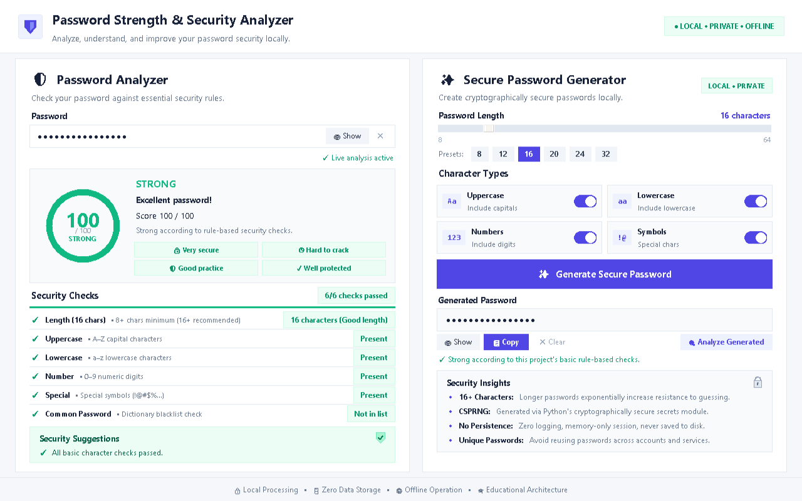

# Password Strength & Security Analyzer

A clean, modern, beginner-friendly desktop cybersecurity application built with Python and Tkinter. The application provides real-time live password analysis, common-password dictionary detection, transparent educational strength scoring, and cryptographically secure password generation with zero external dependencies.

---

## Overview

The **Password Strength & Security Analyzer** is an educational cybersecurity desktop application engineered to demonstrate foundational defensive security principles:
- **Live Password Analysis:** Immediate heuristic feedback evaluated as the user types without requiring manual submission buttons.
- **Password Hygiene:** Educational guidance highlighting the importance of character diversity, length scaling, and avoiding common dictionary patterns.
- **Common-Password Detection:** Instant O(1) matching against a local blacklist of known breached and frequently guessed passwords.
- **Rule-Based Strength Scoring:** A transparent 0–100 heuristic scoring model that rewards length and character diversity while penalizing single-type patterns and dictionary words.
- **Secure Password Generation:** Unpredictable, cryptographically secure password generation using Python's standard `secrets` module.

The application operates **100% locally and offline** in memory, with zero telemetry, zero logging, and zero persistent disk storage.

> 🌐 **Web Edition Available:** A complete, zero-knowledge, 100% client-side Web Edition is available in [`web/`](web/) for instant deployment to Vercel, Netlify, or GitHub Pages with no Python or server runtime required. See [`web/README.md`](web/README.md) for details.

---

## Features

### 🛡️ Password Analyzer
- **Real-Time Live Analysis:** Analysis updates dynamically with every keystroke entered, deleted, or pasted.
- **Circular Strength Gauge Centerpiece:** Visual Canvas-drawn 136px circular score ring featuring a dynamic progress arc and central score readout.
- **Strength Classification:**
  - **WEAK (0 – 39):** High vulnerability (common passwords, extremely short length, or single character type).
  - **MEDIUM (40 – 69):** Moderate complexity; requires additional length or missing character classes to achieve Strong.
  - **STRONG (70 – 100):** Robust length with all four character classes represented.
- **Educational Status Chips:** Dynamic contextual tags highlighting security posture (`🔒 Very secure`, `◷ Hard to crack`, `🛡 Good practice`, `✓ Well protected`).
- **Security Checks with Progress Bar:**
  - Length check (<8 needs improvement, 8–11 acceptable, 12+ good length)
  - Uppercase letters (`A–Z`)
  - Lowercase letters (`a–z`)
  - Numeric digits (`0–9`)
  - Special characters (`! @ # $ % ^ & * ( ) _ - + =`, etc.)
  - Common-password dictionary check
  - Visual passed checks badge (`6/6 checks passed`) and thin progress indicator bar.
- **Security Suggestions Card:** Dedicated soft mint callout card with a custom vector shield emblem providing actionable recommendations and critical blacklist warnings.
- **Masking Controls:** One-click `👁 Show` / `👁 Hide` toggle and `✕ Clear` button.

### ✨ Secure Password Generator
- **Cryptographically Secure Randomness (CSPRNG):** Powered strictly by Python's `secrets` module (never predictable `random`).
- **Configurable Length:** Interactive slider and direct presets (`8`, `12`, `16`, `20`, `24`, `32`) supporting lengths from 8 to 64 characters (default: 16).
- **2×2 Character Types Grid:** Compact, modern card tiles with Canvas toggle switches for Uppercase (`Aa`), Lowercase (`aa`), Numbers (`123`), and Symbols (`!@`).
- **Guaranteed Category Representation:** Guarantees that at least one character from every selected category is included, followed by a CSPRNG shuffle.
- **Quick Action Bar:**
  - `👁 Show` / `👁 Hide` masking toggle.
  - `📋 Copy` copies generated password directly to the OS clipboard.
  - `✕ Clear` wipes the generated password.
  - `🔍 Analyze Generated` bridges the generated password into the analyzer for immediate live evaluation.
- **Security Insights Card:** Reassurance panel with a vector padlock illustration explaining length scaling, CSPRNG mechanics, and memory isolation.

---

## Screenshots



---

## Technology Stack

- **Python Version:** Python 3.10+ (Tested on Python 3.10, 3.11, 3.12, 3.13)
- **GUI Framework:** `tkinter`, `tkinter.ttk`, `tkinter.Canvas` (Standard Library)
- **CSPRNG Security:** `secrets`, `secrets.SystemRandom` (Standard Library)
- **Character Sets:** `string` (Standard Library)
- **Path Operations:** `pathlib`, `os` (Standard Library)
- **Type Annotations:** `typing` (Standard Library)
- **Third-Party Dependencies:** **None** (100% Standard Library)

---

## Architecture

The project maintains clean modular separation between GUI presentation and cybersecurity logic:

```text
password-strength-analyzer/
│
├── app.py                   # Presentation Layer: Tkinter desktop UI & live event controller
├── password_checker.py      # Domain Layer: Analysis criteria, scoring formula & suggestions
├── password_generator.py    # Domain Layer: CSPRNG generation, category constraints & validation
├── common_passwords.txt     # Data Layer: Curated educational blacklist of common passwords
├── requirements.txt         # Architecture Documentation: Confirms zero external dependencies
├── README.md                # Comprehensive documentation & test report
├── .gitignore               # Version control exclusion rules
└── screenshots/             # Interface showcase images
    ├── dashboard.png
    └── empty_state.png
```

### Module Responsibilities

1. **[`app.py`](app.py):**
   - Renders the high-contrast light cybersecurity dashboard (two-column layout: ~52% Analyzer, ~48% Generator).
   - Manages interactive Tkinter components: circular Canvas score ring, 2×2 toggle switches, length slider, and masked inputs.
   - Binds reactive `StringVar` traces for instant live analysis on every keystroke.
   - Executes OS clipboard actions without file logging.

2. **[`password_checker.py`](password_checker.py):**
   - Performs pure in-memory evaluation of passwords against length, case, digits, and symbols.
   - Loads `common_passwords.txt` into a memory `Set[str]` for O(1) dictionary matching.
   - Calculates the transparent 0–100 educational heuristic score.
   - Generates contextual security recommendations.

3. **[`password_generator.py`](password_generator.py):**
   - Validates length boundaries (8 to 64).
   - Draws unpredictable characters using `secrets.choice()` and shuffles with `secrets.SystemRandom().shuffle()`.
   - Guarantees representation from each enabled category and validates the final candidate against common dictionaries.

4. **[`common_passwords.txt`](common_passwords.txt):**
   - Curated plain-text dictionary containing frequently compromised and guessed passwords (e.g., `123456`, `password`, `qwerty`, `admin123`).

---

## How It Works

### Password Analysis Flow
```
User enters password
       ↓
Live reactive event (StringVar trace)
       ↓
Character criteria evaluation (Length, Upper, Lower, Numbers, Symbols)
       ↓
Local common-password dictionary lookup (O(1) Set)
       ↓
Rule-based scoring computation (0–100 with critical overrides)
       ↓
Classification determination (WEAK / MEDIUM / STRONG)
       ↓
Contextual security suggestions rendered
```

### Secure Password Generation Flow
```
User selects target length & character categories
       ↓
Boundary validation (8 ≤ length ≤ 64)
       ↓
Guaranteed representation: 1 character drawn per selected category via secrets.choice()
       ↓
Remaining characters drawn from combined category pool via secrets.choice()
       ↓
Cryptographically secure shuffle via secrets.SystemRandom().shuffle()
       ↓
Sanity verification & common-dictionary filter
       ↓
Masked password displayed with instant Copy & Analyze options
```

---

## Security & Privacy Model

### Local In-Memory Processing
> **Privacy Guarantee:** Passwords are processed locally in memory and are not intentionally stored, logged, or transmitted by this application.

- **Zero Network Activity:** The application opens no sockets, makes no HTTP requests, loads no network libraries, and makes no API calls.
- **Zero Disk Persistence:** Analyzed and generated passwords are never written to disk, databases, temporary scratch files, or configuration caches.
- **Zero Logging:** No plaintext or hashed credentials are sent to log files or standard output.

### Clipboard Handling
> **Clipboard Operation:** Clipboard copying is an operating-system clipboard operation and is outside the application's persistent storage.

When the user clicks `📋 Copy`, the password string is transferred to the operating system's transient clipboard buffer using Tkinter's clipboard API. No secondary clipboard cache is maintained.

### Technically Honest Security Disclaimers
This software is designed as an educational tool and adheres to honest technical disclosures:
- We do **NOT** claim to generate a "100% secure password".
- We do **NOT** claim passwords evaluated as Strong are "impossible to crack".
- We do **NOT** guarantee absolute protection against targeted cryptanalysis, keyloggers, or memory scraping.

---

## Scoring Model & Rules

> **Educational Disclaimer:** The score is an educational, rule-based heuristic and is not a substitute for professional password auditing or breach verification.

The score (0 to 100) is calculated strictly using deterministic educational rules:

### 1. Length Points (Max 45 pts)
| Password Length | Points Awarded | Breakdown Description |
|---|---|---|
| Less than 6 characters | `0 pts` | Very short length |
| 6 to 7 characters | `+10 pts` | Short length |
| 8 to 11 characters | `+25 pts` | Acceptable length |
| 12 to 15 characters | `+35 pts` | Good length |
| 16 or more characters | `+45 pts` | Great length |

### 2. Character Class Variety (Max 40 pts)
| Character Category | Points Awarded |
|---|---|
| Contains uppercase letter (`A-Z`) | `+10 pts` |
| Contains lowercase letter (`a-z`) | `+10 pts` |
| Contains numeric digit (`0-9`) | `+10 pts` |
| Contains special symbol (`!@#$%...`) | `+10 pts` |

### 3. Diversity Bonuses & Penalties (Max +15 pts / Min -15 pts)
| Condition | Points Adjustment |
|---|---|
| All 4 character classes present | `+15 pts bonus` |
| 3 character classes present | `+5 pts bonus` |
| Only 1 character class present (length ≥ 6) | `-15 pts penalty` |

### 4. Critical Safety Overrides & Caps
| Trigger | Effect |
|---|---|
| **Common Password Detected** | **Score capped at 10 (Classified as WEAK)** |
| **Length < 6 characters** | **Score capped at 20 (Classified as WEAK)** |

### 5. Final Classification Thresholds
- **WEAK:** `0 – 39 pts` (or any common password)
- **MEDIUM:** `40 – 69 pts`
- **STRONG:** `70 – 100 pts`

---

## Installation & Running

### Prerequisites
- Python 3.10 or higher.
- Tkinter (included by default in standard Python installers for Windows and macOS).

### Installation
1. Clone the repository:
   ```bash
   git clone https://github.com/your-username/password-strength-analyzer.git
   cd password-strength-analyzer
   ```

2. Verify standard library dependencies (no pip packages needed):
   ```bash
   python -m py_compile app.py password_checker.py password_generator.py
   ```

3. Launch the desktop application:
   ```bash
   python app.py
   ```

*Note for Linux users:* If Tkinter is not bundled with your distribution, install it via:
```bash
sudo apt install python3-tk
```

---

## Automated Testing & Quality Assurance

The application includes automated test suites verifying scoring boundaries, generator randomness, UI regressions, and security invariants.

To execute the Phase 6 test suite:
```bash
python scratch/test_phase6_hardening.py
```

### Verification Matrix
- **Unit Analysis Tests:** 10/10 test cases verified (common detection, class verification, short/long boundaries).
- **CSPRNG Generator Tests:** 10/10 test cases verified (length boundaries 8–64, category enforcement, zero categories rejected).
- **GUI Controls & Live Analysis:** 10/10 interactive workflows verified (live typing, show/hide, presets, slider, copy, transfer).
- **Edge Cases & Robustness:** 10/10 edge cases verified (1-char, 10,000-char input in 0.03 ms, Unicode/emojis, repeated chars).
- **Security & Privacy Audits:** Zero logging, zero network modules imported, verified CSPRNG usage.

---

## Final QA Test Report

```text
=============================================================================
FINAL PHASE 6 SECURITY HARDENING & QA REPORT
=============================================================================
Security Analysis Engine:           PASS (10/10 cases verified)
Common Password Detection:          PASS (100% case-insensitive O(1) match)
Live Analysis Responsiveness:       PASS (Instant keystroke recalculation)
Score Boundary Enforcement:         PASS (39=WEAK, 40=MEDIUM, 69=MEDIUM, 70=STRONG)
Generator Cryptographic Security:   PASS (secrets module CSPRNG verified)
GUI Regression Testing:             PASS (All 10 interactive controls verified)
Password Logging Audit:             PASS (Zero print, zero logging, zero disk I/O)
Network Activity Audit:             PASS (Zero network modules or sockets loaded)
Code Compilation:                   PASS (py_compile 0 errors across all files)
=============================================================================
OVERALL STATUS: 100% PASSED (Production & Portfolio Ready)
=============================================================================
```

---

## Project Limitations

To maintain academic and professional transparency, note the following educational boundaries:
1. **Local Common-Password List:** The bundled `common_passwords.txt` is a curated educational list of ~110 frequently used passwords; it is not a multi-million entry breach database like HaveIBeenPwned.
2. **Rule-Based Heuristics vs. Real-World Cracking:** Rule-based heuristics evaluate structural complexity; they cannot simulate GPU cluster hash-cracking rates (e.g., Hashcat with custom rule masks) or targeted social engineering.
3. **No Online Breach Checking:** To preserve 100% offline privacy, the app does not query k-anonymity breach APIs over the internet.
4. **No Password Manager Integration:** Does not store vaults or sync credentials across devices.
5. **No Attacker Simulation:** Does not model credential stuffing attacks with victim-specific dictionaries.

---

## Future Improvements

Potential future enhancements for academic exploration:
- Integration of a larger local compromised-password bloom filter.
- Shannon entropy and zxcvbn-style pattern matching estimation.
- Diceware multi-word passphrase generator and evaluator.
- Configurable enterprise complexity policy enforcement (e.g., NIST SP 800-63B guidelines).
- High-contrast accessibility modes and keyboard navigation enhancements.
- Multilingual localization support.

---

## License

This project is licensed under the [MIT License](LICENSE).
